# forgedex

Hand-forge Android APKs with a macro assembler — no Java, no SDK, no Gradle.

An example is one `.asm` file. [fasmg](https://flatassembler.net/) reads it and
writes `classes.dex` directly: the string, type, prototype, field and method
pools, the class data, the bytecode, the offsets, the checksums. A shell script
zips that together with a manifest and signs it. Nothing in the chain has heard
of Android Studio.

```asm
method "->onClick(Landroid/view/View;)V", ACC_PUBLIC, locals 4
    iget           v0, p0, "->count:I"
    add_int_lit8   v0, v0, 1
    iput           v0, p0, "->count:I"

    rem_int_lit8   v1, v0, 15
    if_nez         v1, .not_fizzbuzz
    const_string   v3, "FizzBuzz"
    goto           .show
.not_fizzbuzz:
    ...
```

---

## How it works

`forgedex.inc` is the DSL: a map of the format that includes the twelve files
under `forge/`, one per part — the hashes the header carries, the five id pools,
the instruction formats, the references. Writing an example means declaring
classes, fields and methods and then writing Dalvik bytecode as mnemonics; the
assembler works out the rest.

Two more formats are forged the same way. `forgeaxml.inc` writes the binary
`AndroidManifest.xml` and layouts from `.asm` sources, and `forgeres.inc` writes
`resources.arsc` — which is what an `aapt` would otherwise be here for.

* **The pools derive themselves.** `const_string v3, "FizzBuzz"` interns the
  text, `invoke_virtual "Landroid/widget/TextView;->setText(...)V"` interns the
  type, the prototype and the method reference. Nothing is numbered by hand, and
  the pools come out sorted as the format requires.
* **Branches go to labels.** `if_eq v5, v1, .plus`, not a counted offset.
* **Registers have names.** `v0`–`v255` are constants; a method's parameters are
  `p0`, `p1`, … and the assembler works out which registers those are from the
  frame size and the signature.
* **The frame is checked.** `outs_size` is derived from the invokes in the body,
  and a register outside `registers_size` is an error rather than a corrupt dex.
* **Widths are checked.** fasmg's `db`/`dw`/`dd` widen a too-large value instead
  of truncating it, which silently shifts everything after it in the file; every
  field goes through a macro that range-checks first.

Wide values (`long`, `double`) occupy register pairs, and the instructions that
move them reserve the second half.

---

## Prerequisites

| Tool | For |
|------|-----|
| **fasm** | bootstrapping fasmg — `apt install fasm` |
| **fasmg** | the assembler; built by `setup_deps.sh` from [tgrysztar/fasmg](https://github.com/tgrysztar/fasmg) |
| **apksign** | signing, and the key to sign with; built by `setup_deps.sh` from [vitalnodo/apksign](https://github.com/vitalnodo/apksign), needs [Zig](https://ziglang.org/) 0.17.0 |
| **zig** | cross-compiles the native libraries — only for the four that carry a `.so` |
| **adb** | installing to a device (optional) |

There is no Java, no Android SDK, no `aapt`, no `openssl` and no NDK in that
list, and that is the point. The binary manifest and the resource table are
assembled by fasmg like everything else; `apksign` mints its own signing key.

```sh
sh setup_deps.sh     # clones and builds into deps/
```

To remove: `rm -rf deps/`.

---

## Build

```sh
make                          # what there is to run
make all                      # every example
make raycaster                # one of them
make raycaster-install        # build, install and launch over adb
make raycaster-uninstall
make check                    # build, then verify the dex checksums
```

Or directly:

```sh
sh examples/raycaster/build.sh [--install|--uninstall]
```

Signing keys are generated into `keys/` on first use. `hello_adb` needs none.

The examples declare **minSdkVersion 21** (Android 5.0) and **targetSdkVersion
33** (Android 13), and both are worth playing with. Changing them for everything
is one line in `tools/manifest.inc`; an example can also take its own pair:

```asm
app_manifest "app.hello.canvas", "Canvas", "CanvasDemo", minsdk:16, targetsdk:29
```

Every APK is signed with schemes v1 and v2 either way.

---

## Examples

### hello_adb

`HELLO` on the terminal, through `dalvikvm` on the device — no APK, no manifest,
no signing. Where the repository started, kept for that reason.

Based on a post by [MaoKo](https://github.com/MaoKo) on the
[flat assembler message board](https://board.flatassembler.net/topic.php?t=21689).

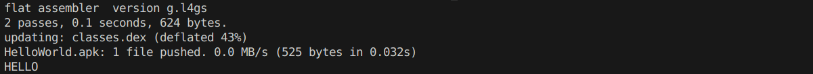

### hello_gui

An `Activity` and a `TextView` — the shortest complete APK here, 31 lines.

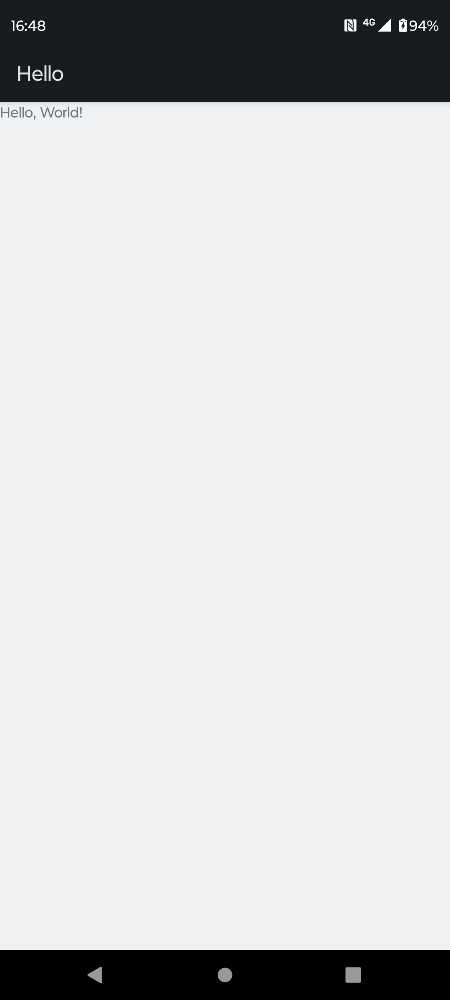

### counter_plus_minus

A label and two buttons. Instance fields, a click listener, a `LinearLayout`.

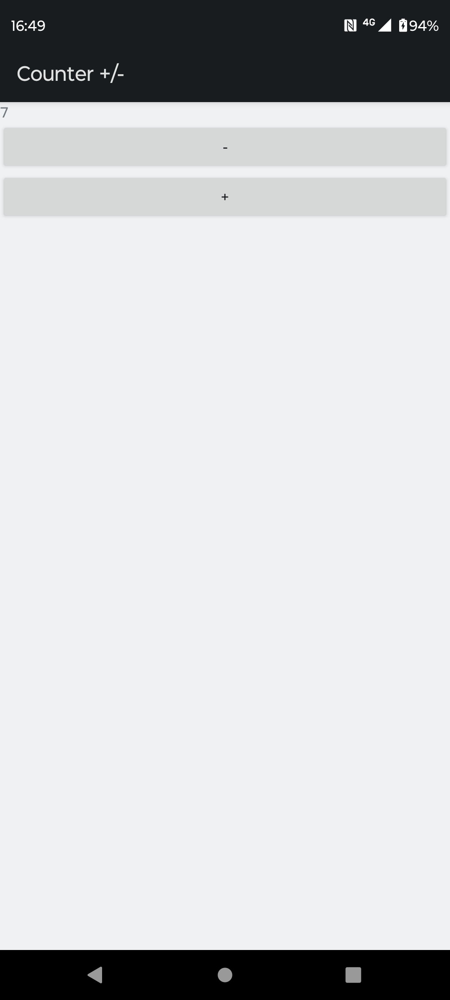

### fizzbuzz

Control flow: branches to labels, `rem-int`, a chain of `else if`.

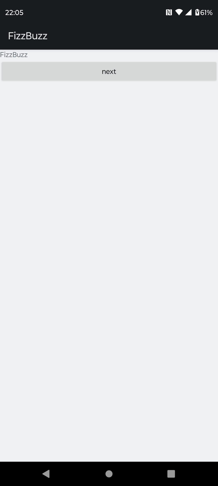

### canvas

A `View` of its own that keeps a `Bitmap` at its own size and draws into it from
`onTouchEvent` — finger painting.

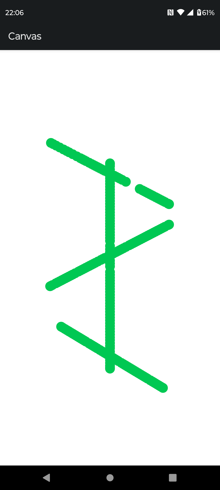

### fetch

Types an address, fetches it on a worker thread, shows the page on a second
screen. `java.net.URL`, `Thread`, an `INTERNET` permission in the manifest, and
three classes in one dex.

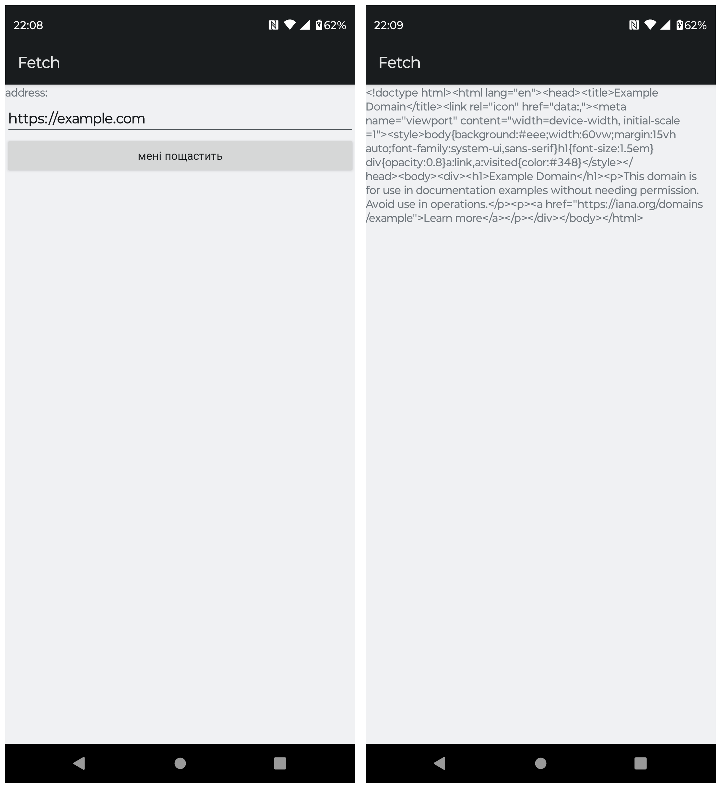

### raycaster

One ray per screen column against a map held as a 256-character string. Sixteen
live doubles in one frame, which is what the wide-register work was for. No
perspective transform and no polygon anywhere.

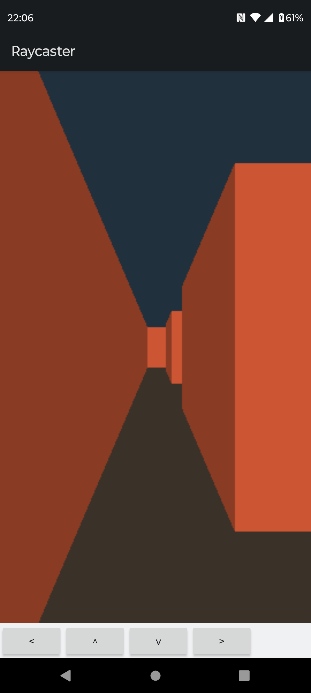

### hello_jni

The smallest native call: `System.loadLibrary`, one `native` method, a string
back from C. The `.so` is cross-compiled with `zig cc`.

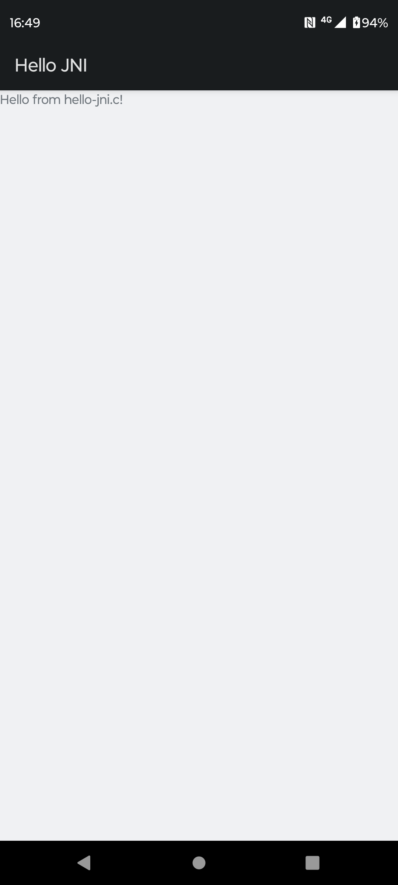

### dtmf

A telephone keypad that sends real touch tones.

The tones are not computed by any C written for this repository. They come from
the winning **IOCCC 2020** entry
[Most phony](https://www.ioccc.org/2020/giles/index.html) by **Edward Giles**,
whose source is laid out in the shape of a telephone handset — it is in
`examples/dtmf/ioccc/` exactly as submitted.

It is a command-line program that reads and writes WAV files, so between it and
the `Activity` sits `examples/dtmf/shim/`: the fifteen functions of `<stdio.h>`
and `<string.h>` it calls, reimplemented over plain memory. Two compiler flags
do the rest, and the entry itself is untouched. It never learns it is in an APK.

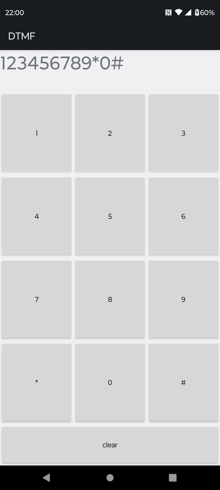

### nativewin

A plasma, drawn by C straight into the window's own buffer. A `SurfaceView`
hands its `Surface` across the JNI boundary once; from then on the native side
locks the buffer, writes pixels and posts it. The dex holds no drawing
instruction at all — only a `Runnable` that asks for the next frame.

That needs `libandroid.so`, which comes with the NDK, and the NDK is what this
repository does without. So `examples/nativewin/stub/` holds a **forged**
`libandroid.so`: the right soname, the five names the linker is looking for, and
nothing behind them. It satisfies the link; the device satisfies the load.

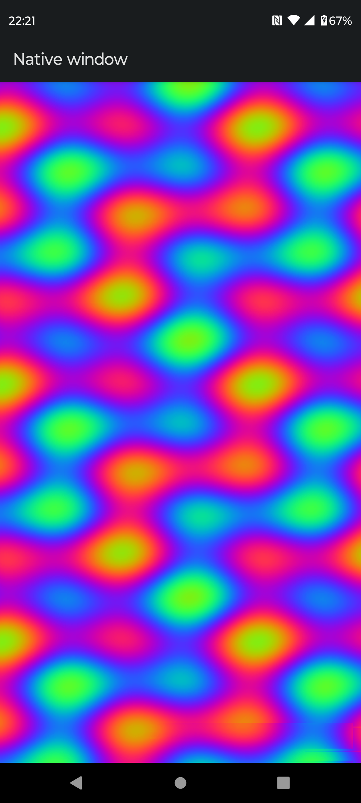

### shaders

A ray marched sphere over a checkerboard, lit and orbited — the scene every
introduction to shaders arrives at, on a phone, with no NDK.

The Dalvik side is `nativewin`'s: a `SurfaceView` across the JNI boundary and a
`Runnable` asking for frames. What changes is that nobody writes pixels any
more. C brings up an EGL context and hands the driver a fragment shader as
text; the sphere and the floor exist only as a distance function inside it.
It is `raycaster`'s idea grown a dimension and moved to hardware built for it.

Three forged libraries this time — `libEGL.so`, `libGLESv2.so`, `libandroid.so`.

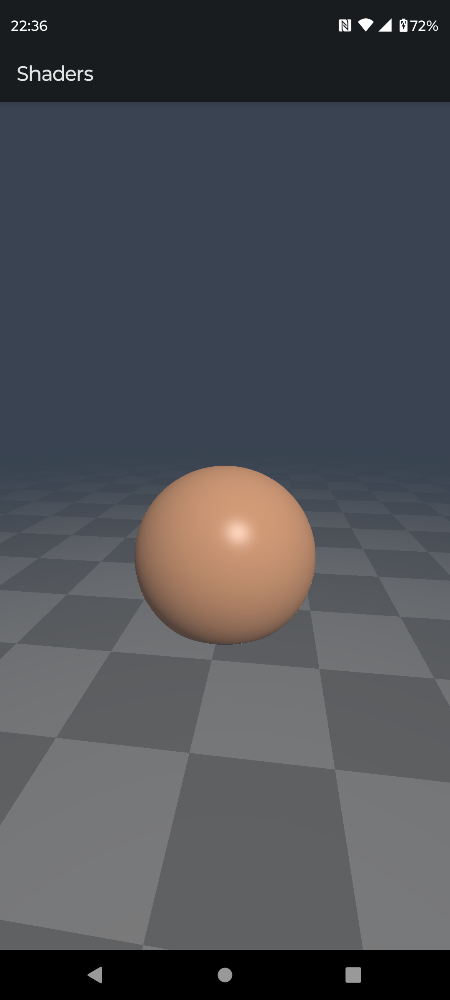

### themes

A gallery of widgets — text entry, buttons, a checkbox and a switch, radios, a
slider, progress of both kinds, a star rating, an analogue clock and a
stopwatch, and the project's own icon — inflated from a forged layout, under
thirteen platform themes that swipe from one to the next. The screen scrolls;
the picture below is its top and its bottom.

The only example with a **resource table**. `res.asm` becomes `resources.arsc`,
`screen.asm` becomes `res/layout/screen.xml`, and an icon goes in as a file;
the ids that tie them together are declared once and read by both. Which theme
a window gets is not chosen by any code — it is an `android:theme` reference in
the manifest, resolved by the platform, so the thirteen activities differ only
in that one attribute.

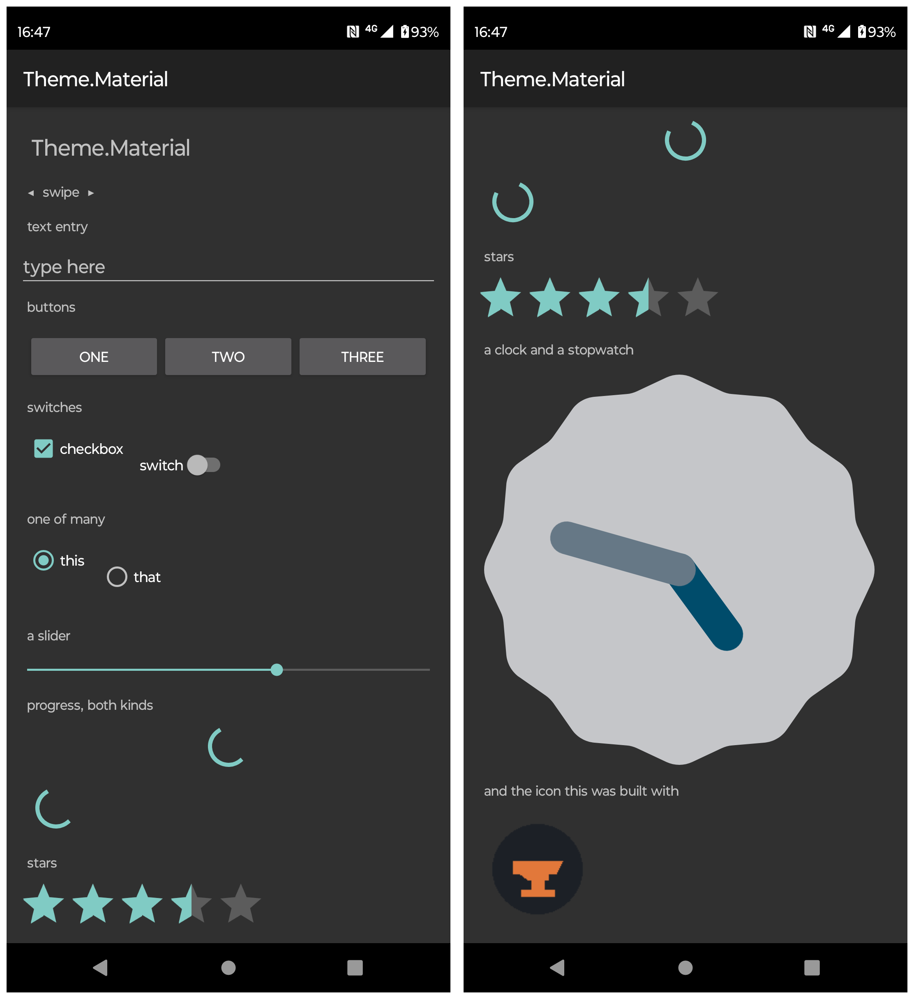

---

## Layout

```
forgedex.inc          the DSL — a map of forge/
forge/                one file per part of the dex format
forgeaxml.inc         binary AndroidManifest.xml and layouts
forgeres.inc          resources.arsc
include/jni.h         so the native examples need no NDK
tools/build.sh        the build every example shares
tools/manifest.inc    the manifest an example gets for three names
examples/*/           one .asm, a manifest, and four names in a build.sh
  nativewin/stub/     forged .so files, for link time only — these two
  shaders/stub/       examples only, and never loaded on the device
deps/                 built by setup_deps.sh, not committed
keys/                 generated on first build, not committed
```

An example's `build.sh` holds only what differs:

```sh
ASM=raycaster.asm
PACKAGE=app.hello.ray
ACTIVITY=.Main

. ../../tools/build.sh
```

---

## Native libraries

Four examples carry a `.so`, and none of them needs the NDK.

`hello_jni` and `dtmf` come out **freestanding**: no `DT_NEEDED`, no undefined
symbols, nothing linked. Everything they need of the outside world arrives
through the `JNIEnv` function table, which is why
`zig cc -target aarch64-linux-musl` produces something bionic will load —
nothing from musl is ever called. That constraint is why `dtmf` has a shim
instead of a libc.

`nativewin` and `shaders` do need platform libraries, and get at them by
linking against a stub `.so` it forges itself: the soname and the symbol names
are all the linker ever wanted, and the device supplies the code. Anything on
the device is reachable this way — `liblog.so`, `libEGL`, `libaaudio.so`.

An example declares what it may ask the loader for:

```sh
NATIVE_NEEDS="libandroid.so"
```

and `tools/build.sh` compares that against the `.so`'s actual `DT_NEEDED` after
every build. Unset means freestanding. A stray libc call then fails the build
instead of the app.

---

## History

I remember J2ME. An app was about a megabyte and did a great deal with it —
Doom II RPG is the one that stays with me, a first-person dungeon crawler with
combat and conversation, on a phone with a numeric keypad. Then for a while it
looked as though phones might simply run Linux. That went differently, but
Android stayed hacker-friendly for a long time, and then by degrees stopped
being. Apps kept growing and I could not account for where the space went.
Wanting to see the process for myself is where this started.

[cnlohr/rawdrawandroid](https://github.com/cnlohr/rawdrawandroid) is where to
start: Android apps with no Java and no Studio, driven by a Makefile. The SDK
and the NDK are still underneath it, so it is the tip of the iceberg rather
than the whole of it — but a useful tip.

What made the rest look possible was
[akavel/hellomello](https://github.com/akavel/hellomello), which builds real
Android apps in Nim — [a talk about it
here](https://www.youtube.com/watch?v=wr9X5NCwPlI). Seeing a working thing is
worth more than any amount of theory; I helped bring its flappy bird example
back to life, which mostly meant filling in Android APIs it was missing.

Then I thought it might be worth doing in Zig. That attempt went the obvious
way: a compiler, with an intermediate representation, from a smali-like
language — and respect to smali, which is where a lot of this thinking comes
from. It got as far as a button with text on it and no further. It did not feel
serious, and assembling turns out to want a different shape of tool than
compiling does.

Then fasm, and its extension [fasmg](https://flatassembler.net/), whose macro
system is far more powerful than I expected. And then
[MaoKo](https://github.com/MaoKo)'s 2020 post on the
[flat assembler message board](https://board.flatassembler.net/topic.php?t=21689):
a hello world, assembled by hand, run through `dalvikvm` over adb. That was the
one — after some prodding it grew a window, and everything here follows from
it.

I put it down and picked it up again more than once, and some of the
breakthroughs came out of working with LLMs, latterly Opus 5.

A curiosity picked up on the way, since it belongs nowhere else: the author of
the Dalvik VM owns the domain `milk.com`.

## Where it could go

It has been an interesting road and I would like to work on something else now.
What I hope is that this is useful to anyone curious about what is actually
under Android — the formats are not secret, they are just undocumented enough
to be tedious, and most of that tedium is now written down in `forge/`.

Things I would find interesting, if anyone wants them:

* more of fasmg's CALM instructions, which the DSL barely touches;
* checking whether the signer is actually sound — it signs, it is not reviewed;
* trickier examples, and `try`/`catch`, which the DSL has no answer for yet;
* more borrowed from smali;
* [Kaitai Struct](https://kaitai.io/) descriptions of these formats — the
  [format library](https://formats.kaitai.io/) has no `.ksy` for AXML or
  `resources.arsc` at all, and [the one for
  dex](https://formats.kaitai.io/dex/) stops before `code_item` and the
  annotation structures;
* a GUI library on top, the way [Capy was ported to
  Android](https://capy-ui.org/blog/porting-capy-to-android/);
* a GUI editor, for that matter;
* or something else entirely — a MidletPascal for this, or bytecode translated
  from wasm the way [Chicory](https://github.com/dylibso/chicory) does it.

fasmg simply turned out to be strong enough for all of this. Go on — I would
like to see what people build.

---

## Licence

MIT, except `examples/dtmf/ioccc/`, which is the IOCCC entry under CC BY-SA 4.0
— see the README in that directory.
